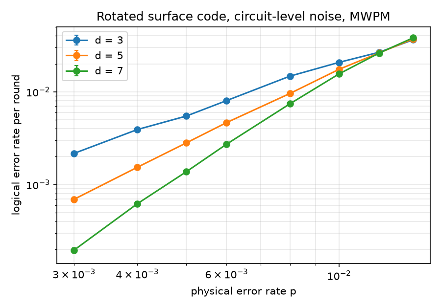
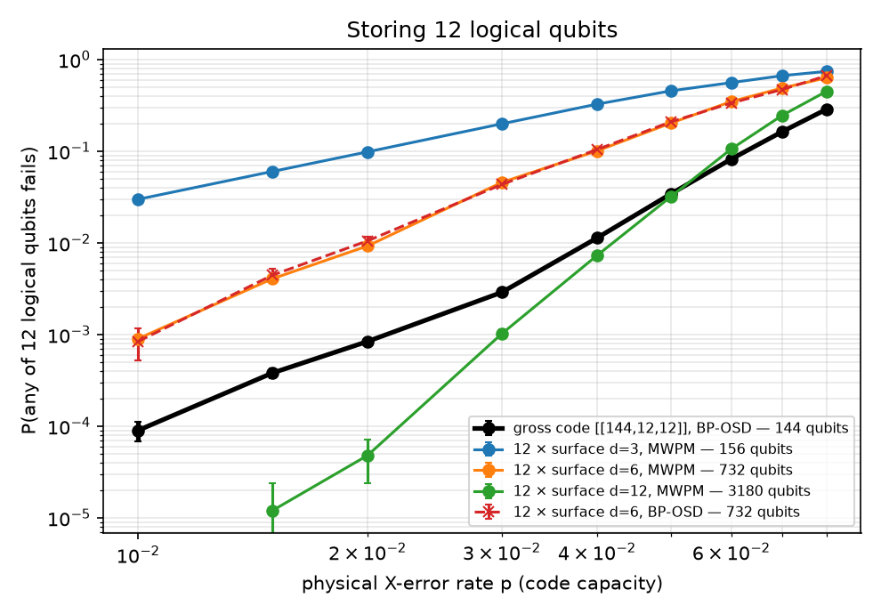

# Decoding quantum codes: surface code vs. IBM's gross code

A self-contained study of **quantum error-correction decoding** in Python. The repository contains one notebook, `qec_decoding.ipynb` (executed, with outputs), and a small helper module, `qec_tools.py`.

1. **Surface code under circuit-level noise.** Rotated surface-code memory experiments (d = 3, 5, 7) are simulated with [Stim](https://github.com/quantumlib/Stim) and decoded with minimum-weight perfect matching ([PyMatching](https://github.com/oscarhiggott/PyMatching)).
2. **IBM's [[144, 12, 12]] bivariate bicycle "gross" code.** The code is built from its polynomial definition (Bravyi et al., *Nature* 2024), checked over GF(2), and decoded with BP-OSD ([ldpc](https://github.com/quantumgizmos/ldpc)).
3. **Decoder sensitivity.** How the min-sum scaling factor changes BP-OSD performance on the gross code.
4. **Gross code vs. surface codes.** Storing 12 logical qubits at a similar and at a much larger qubit budget.

## Results

### Surface code threshold (circuit-level depolarizing noise, MWPM)



- Below threshold, going from d = 3 to d = 7 lowers the per-round logical error rate about 10× at p = 0.3 %.
- The d = 5 / d = 7 curves cross at **p ≈ 0.7 % per shot** (≈ 1.2 % per round). This is approximate, because near the crossing the curves differ by less than their statistical noise.

### Gross code vs. surface codes (code capacity, 12 logical qubits)



The table shows the probability that any of the 12 logical qubits fails.

| p | gross code, BP-OSD (144 qubits) | 12 × surface d=3 (156) | 12 × surface d=6 (732) | 12 × surface d=12 (3 180) |
|---|---|---|---|---|
| 1 % | 9.0e-5 | 3.0e-2 | 9.0e-4 | 0 in 10⁶ shots |
| 2 % | 8.4e-4 | 9.8e-2 | 9.2e-3 | 4.8e-5 |
| 4 % | 1.1e-2 | 3.3e-1 | 1.0e-1 | 7.3e-3 |
| 6 % | 8.2e-2 | 5.6e-1 | 3.5e-1 | 1.1e-1 |

- **Low overhead:** at p = 1–2 % the gross code fails about **100–330× less often** than 12 surface-code patches with a similar qubit budget. It also fails about 10× less often than patches that use 5× more qubits.
- **Not a free lunch:** 12 distance-12 surface-code patches (22× more qubits) are still better at low p. The gross code catches up only around p ≈ 5 %.
- **Decoder tuning matters:** at p = 4 %, plain min-sum BP-OSD (α = 1) fails **22.7 %** of the time on the gross code, versus **≈ 1 %** for normalised min-sum (α = 0.5–0.9).
- **MWPM and BP-OSD agree on the surface code** (d = 6): the curves overlap.

## Limitations

- Parts 2–4 use **code-capacity** noise: i.i.d. X errors and perfect syndromes. Circuit-level performance of the gross code needs a dedicated syndrome-extraction circuit and is much harder to simulate.
- **Decoder speed:** BP-OSD with order-7 OSD is accurate but slow. Real-time decoding is a separate problem; see IBM's Relay-BP (arXiv:2506.01779).
- **Distance:** the gross code's distance (12) is taken from the paper, not recomputed here. The notebook checks only that a weight-12 logical operator exists.

## Run it

```bash
pip install -r requirements.txt
jupyter lab qec_decoding.ipynb
```

The notebook takes about 4 minutes on a laptop CPU, with a fixed random seed.

## References

- Bravyi, Cross, Gambetta, Maslov, Rall, Yoder, *High-threshold and low-overhead fault-tolerant quantum memory*, Nature 627, 778 (2024).
- Gidney, *Stim: a fast stabilizer circuit simulator*, Quantum 5, 497 (2021).
- Higgott & Gidney, *Sparse Blossom: correcting a million errors per core second with minimum-weight matching*, Quantum 9, 1600 (2025).
- Panteleev & Kalachev, *Degenerate quantum LDPC codes with good finite length performance*, Quantum 5, 585 (2021).
- Roffe, White, Burton, Campbell, *Decoding across the quantum low-density parity-check code landscape*, Phys. Rev. Research 2, 043423 (2020).
- Müller et al., *Improved belief propagation is sufficient for real-time decoding of quantum memory*, arXiv:2506.01779 (2025).

*Code written with the help of an AI coding assistant. The study design, runs and interpretation are my own.*
